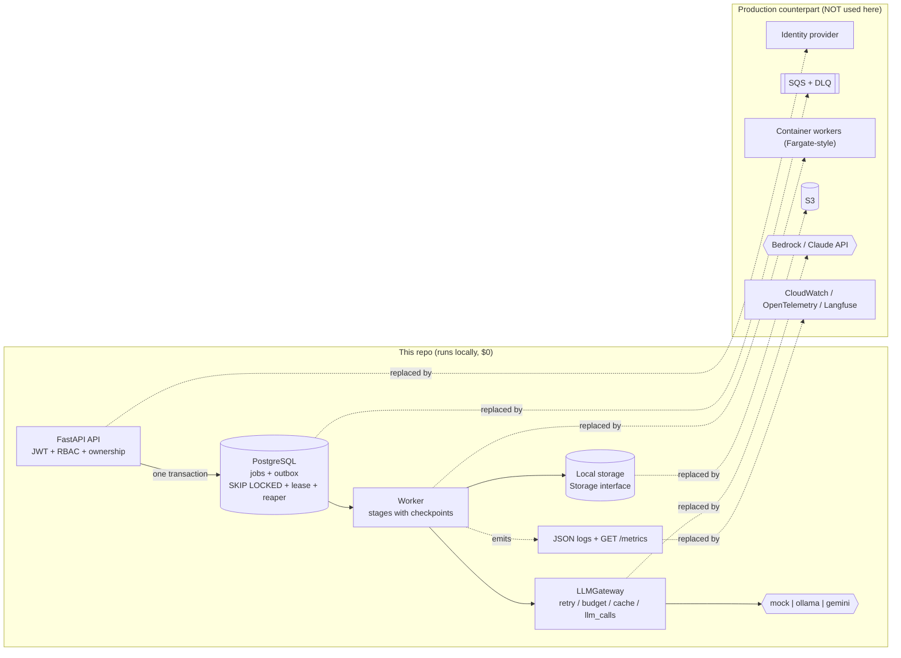

# AI-Powered Project Evaluation Platform — proof of concept

A small, runnable POC of the **core logic** of an automated project-evaluation platform: submissions with
seven artifact types go through a queue-backed pipeline (extract → deterministic facts → summaries →
one LLM call per rubric criterion → aggregate → route), and a human reviewer can approve, override,
reject and publish results.

It costs nothing to run: no cloud accounts, no paid services. The default LLM is a **deterministic mock**.
It is a heuristic stand-in, not a model, so scores in this repo say nothing about real grading quality.

> **Honesty note.** This POC does **not** use AWS, S3, SQS, Fargate, GuardDuty or any Bedrock/Claude API.
> Those names appear only as the production counterparts each POC piece is shaped to be replaced by.
> **Only the `mock` LLM provider was ever run.** `ollama` and `gemini` have never been run (see
> [`samples/`](samples/README.md), which contains mock output only). Docker files were **written, not run**.

## Quick start (3 commands)

**Windows PowerShell**

```powershell
python -m venv .venv; .\.venv\Scripts\pip install -r requirements.txt
.\.venv\Scripts\python tasks.py up      # Postgres via Docker Compose + create tables + seed users/rubric
.\.venv\Scripts\python tasks.py demo    # full flow end to end with the mock provider
```

**macOS / Linux**

```bash
python3 -m venv .venv && .venv/bin/pip install -r requirements.txt
.venv/bin/python tasks.py up            # Postgres via Docker Compose + create tables + seed users/rubric
.venv/bin/python tasks.py demo          # full flow end to end with the mock provider
```

Other commands: `python tasks.py test | calibrate | cost`. Interactive API docs: run
`uvicorn app.main:app` and open `/docs`. Seeded dev logins (password `password`): `student1@example.com`,
`student2@example.com`, `evaluator@example.com`, `admin@example.com`.

**How this was actually run:** Windows 11, Python 3.12.10, a *portable PostgreSQL 16.15* — **no Docker on
that machine**, so `tasks.py up` (which calls `docker compose`) was never executed. Without Docker, point
`DATABASE_URL` (and `TEST_DATABASE_URL` for tests) at any Postgres 16 (defaults in `.env.example`), run
`python -m app.bootstrap` once, then `python tasks.py test | demo | calibrate | cost`. That is the path
that was verified. Nothing here was run on macOS or Linux.

> **Security warning — `SSRF_ALLOW_PRIVATE`.** A test-only switch that lets the SSRF guard reach loopback
> addresses. It is honored **only when `APP_ENV=test`**; in any other environment it is ignored and a
> warning is logged (tested in `tests/test_hardening.py`). It is deliberately absent from `.env.example`.
> Never set `APP_ENV=test` in a deployment.

## Architecture



| POC piece | Production counterpart it is shaped to be replaced by |
|---|---|
| Postgres `jobs` + `outbox` (SKIP LOCKED, lease, reaper, `dead` = DLQ) | a managed queue such as SQS with a DLQ |
| `Storage` interface → local folder | an object store such as S3 |
| `LLMGateway` → mock / ollama / gemini | a managed model endpoint (Bedrock / Claude API) behind the same gateway |
| JSON logs + `GET /metrics` | CloudWatch / OpenTelemetry / an LLM-tracing tool such as Langfuse |
| Seeded users + JWT | an identity provider |
| ZIP validation + SSRF guard | the same code plus a sandboxed fetcher / egress proxy and a malware scanner |

## Status

Every row is exactly one of: **Implemented and tested** (an automated test in `tests/` passes) ·
**Implemented, not tested** · **Fixture only** (works against local fixtures, not the real service) ·
**Written, not run** · **Not implemented**.

### Features

| Feature | Status | Evidence / caveat |
|---|---|---|
| Idempotent create (same `Idempotency-Key` → one submission, per user) | Implemented and tested | `test_idempotency.py` |
| Start-evaluation ×5 → one job; concurrent start → one active job (`uq_active_job`) | Implemented and tested | `test_start_evaluation_five_times_creates_one_job`, 8 threads behind a barrier |
| Worker claim (SKIP LOCKED), lease, heartbeat, stale-worker fencing | Implemented and tested | `test_queue.py` |
| Crash mid-stage → reaper requeues → resumes without redoing finished stages | Implemented and tested | crash simulated with a `BaseException` |
| Job → `dead` after N failures / via lease expiry | Implemented and tested | `test_queue.py` |
| Optimistic `version` check on checkpoint writes (stale writer rejected) | Implemented and tested | `test_optimistic_version_conflict_rejects_the_stale_writer`. Review actions use a row lock (`FOR UPDATE`) plus a version bump, not a compare-and-set |
| Versioned, immutable-once-published rubrics (DB trigger) | Implemented and tested | `test_rubrics.py` |
| JWT auth, RBAC, ownership (404 for other students' data) | Implemented and tested | expired and tampered tokens → 401 |
| ZIP-slip, ZIP-bomb (ratio + size), file count, symlink, allowlist | Implemented and tested | `test_security.py` |
| SSRF guard (private/loopback/link-local/IPv6-mapped, https-only, redirect re-validation, size cap) | Implemented and tested | DNS-rebinding race **not** closed (documented in `ssrf.py`) |
| `SSRF_ALLOW_PRIVATE` honored only when `APP_ENV=test` | Implemented and tested | `test_hardening.py` |
| Prompt-injection detector + data delimiting | Implemented and tested | regex heuristic; evadable by a determined attacker |
| LLM gateway: retry/backoff, token budget, cache, `llm_calls` log | Implemented and tested | `test_llm_gateway.py` |
| File selection: ranking, ignore lists, chunking | Implemented and tested | `test_hardening.py`, `test_pipeline.py` |
| Context building ("retrieval") | Implemented and tested | **Heuristic file selection only — no embeddings, no pgvector, no semantic search.** Files are ranked by name/path/size tiers and picked per criterion by filename rules, within fixed character budgets |
| One LLM call per criterion; strict pydantic JSON; retry once with the error; then `needs_review` | Implemented and tested | `test_pipeline.py` |
| Evidence hallucination guard (quote must exist verbatim in the cited file) | Implemented and tested | |
| Decimal aggregation | Implemented and tested | float-vs-Decimal case asserted |
| Routing: low confidence, failed/skipped artifact, injection flag, near-boundary score, random audit | Implemented and tested | audit sample is deterministic per job id (10%) |
| Failed artifact → warning + lower confidence + review, never a failed evaluation | Implemented and tested | |
| Evaluator queue, approve / override (new version) / reject, audit log | Implemented and tested | `test_review.py` |
| Publish: one published result (`uq_one_published_result`), double publish → 409, concurrent publish | Implemented and tested | |
| Students see only published results; evaluators see all versions | Implemented and tested | |
| JSON logs with `job_id`/`submission_id`; `GET /metrics` | Implemented and tested | |
| Golden set + `calibrate`; `cost` report (30 and 10,000/day) | Implemented and tested | 3 tiny hand-labelled projects; projection is arithmetic |
| `Dockerfile`, `docker-compose.yml`, `tasks.py up` | Written, not run | Docker not installed on the build machine. Reviewed for: Postgres healthcheck, api bootstraps schema, worker as a separate service waiting on healthy api, uploads volume, non-root user |
| macOS / Linux | Implemented, not tested | only run on Windows 11 |
| Scale to 10,000 submissions/day | Not implemented | numbers are arithmetic, never load-tested |
| Sandboxed code execution, malware scanning, multi-AZ | Not implemented | by design: static analysis only |

### Artifact types (all 7 are accepted by the API and run through the pipeline)

| Artifact | Status | What was actually verified |
|---|---|---|
| `github` | Implemented and tested | against a local git repo (the network clone is swapped for a local one). A separate **manual, non-suite** run cloned `octocat/Hello-World`; a missing repo returned `failed` |
| `zip` | Implemented and tested | extraction, zip-slip rejection, executable skipping |
| `pdf` | Implemented and tested | hand-built PDF; garbage → `failed`; scanned PDFs → `partial` (no OCR) |
| `documentation` | Implemented and tested | md and docx |
| `live_url` | Implemented and tested | real local HTTP server (needs `APP_ENV=test` + `SSRF_ALLOW_PRIVATE`); blocked by default |
| `google_drive` | Fixture only | fixture folders and a *mocked* Drive API response path. The real Google API was never called (no key) |
| `video` | Implemented and tested | transcript path, missing transcript → `partial`, >20 min → `skipped`. The ffprobe and faster-whisper code paths are **Implemented, not tested** (neither is installed here) |

### LLM providers

| Provider | Status | What was actually verified |
|---|---|---|
| `mock` | Implemented and tested | whole suite, demo, calibrate, cost. Deterministic, deliberately gullible to injected text |
| `ollama` | Implemented, not tested | request/response parsing and error mapping are unit-tested against **mocked HTTP only**; never run against a real Ollama server |
| `gemini` | Implemented, not tested | same: mocked HTTP only (parsing, 429/503 retryable, 4xx not, missing key); never called with a real key |

## Test output (working tree, 2026-10-13, Windows 11, Python 3.12.10, PostgreSQL 16.15)

`pytest` against the working tree (the fresh-clone run is recorded in the next section once done):

```
collected 142 items

tests\test_adapters.py ...............                                   [ 10%]
tests\test_auth.py .....                                                 [ 14%]
tests\test_calibrate_cost.py ...                                         [ 16%]
tests\test_hardening.py .........................                        [ 33%]
tests\test_idempotency.py .......                                        [ 38%]
tests\test_llm_gateway.py ........                                       [ 44%]
tests\test_observability.py ....                                         [ 47%]
tests\test_pipeline.py ...........                                       [ 54%]
tests\test_queue.py ........                                             [ 60%]
tests\test_review.py ...........                                         [ 68%]
tests\test_routing.py ......                                             [ 72%]
tests\test_rubrics.py ....                                               [ 75%]
tests\test_security.py ..................................                [ 99%]
tests\test_smoke.py .                                                    [100%]

============================ 142 passed in 52.00s =============================
```

## Demo output (`python tasks.py demo`, mock provider)

*Captured in the earlier clean-clone run, before the Step 2 hardening; re-run results are in the verification section below when present.*

```
== 4. Worker drains the queue
   good: {"status": "completed", "stage": "route", "attempts": 1}
   malicious: {"status": "needs_review", "stage": "route", "attempts": 1}
   bad-zip: {"status": "needs_review", "stage": "route", "attempts": 1}
== 5. Visibility rules
   student reads unpublished result -> HTTP: 404
   other student reads submission -> HTTP: 404
== 6. Evaluator review queue
   malicious: {"total": "100.00", "reasons": ["injection_flag:README.md"]}
   bad-zip: {"total": "17.50", "reasons": ["low_confidence:code_quality=0.30", ..., "artifact_failed:zip(zip rejected: path traversal (zip-slip) ...)"]}
== 7. ...
   publish good: "published"
   publish good again -> HTTP: 409
   override -> new version: {"version": 2, "total": "31.00"}
```

Note the malicious README scored **100.00** from the mock — it is gullible on purpose; the *detector and
routing* are what held it back from the student.

## Golden-set calibration (`python tasks.py calibrate`, mock provider)

| project | expected total | got | delta | routed because |
|---|---|---|---|---|
| good | 82.5 | 79.0 | −3.5 | `random_audit_sample` in this run (deterministic per job id) |
| weak | 22.5 | 33.5 | +11.0 | `low_confidence:code_quality=0.50` |
| malicious_readme | 33.5 | 100.0 | **+66.5** | `injection_flag:README.md` |

Mean absolute total delta 27.0. These measure a heuristic mock against expectations the author
hand-assigned; they are **not** evidence of real-LLM accuracy.

## Cost report (`python tasks.py cost`)

Token counts are the mock's chars/4 estimate; cost uses an *assumed* reference price of $1.00 / 1M input
and $5.00 / 1M output tokens (not a vendor quote). Actual spend here is $0.

| submissions/day | LLM calls/day | tokens/day | est. $/day | est. $/30 days |
|---|---|---|---|---|
| 30 | 200 | 77,070 | 0.10 | 3.05 |
| 10,000 | 66,666 | 25,690,000 | 33.91 | 1,017.30 |

Derived from 6 evaluations averaging 2,364 tokens in / 206 out / 6.7 calls each. This is linear arithmetic
(no retries, no cache hits, mock-sized outputs). It is **not** a load test or capacity test.

## API overview (see `/docs` for the generated OpenAPI)

| Method & path | Who | Purpose |
|---|---|---|
| `POST /auth/login` | anyone | JWT |
| `POST /submissions` (`Idempotency-Key` required) | authenticated | create submission |
| `POST /submissions/{id}/artifacts` | owner | upload/attach one of 7 artifact types |
| `POST /submissions/{id}/evaluations` | owner / staff | start evaluation (idempotent) |
| `GET /evaluations/{id}` | owner / staff | status, stage, attempts |
| `GET /evaluations/{id}/result` | owner → published only; staff → all versions | result |
| `GET /review/queue` | evaluator, admin | evaluations needing review |
| `POST /evaluations/{id}/approve \| override \| reject \| publish` | evaluator, admin | review actions, all audited |
| `GET /metrics` | evaluator, admin | queue depth, oldest job age, tokens, cost |

## Known limitations

- **No sandbox execution.** Student code is never run; everything is static text analysis, so
  "functionality" is inferred from README and structure, not from running the project.
- **No malware scanner.** ZIPs are checked structurally and by file type, not scanned for payloads.
- **No multi-AZ / HA / backups.** Single region, single Postgres.
- **Cost figures are arithmetic, not a load test.** 10,000/day was never run; one in-process worker loop,
  1 s polling, local disk, no rate limiting or backpressure on provider limits.
- **No semantic retrieval.** No embeddings or pgvector; context is chosen by filename/size heuristics.
- **Prompt-injection defence is heuristic** (regex + delimiting + human routing); a paraphrased attack may
  evade it, and only the flagged case is demonstrated against the gullible mock.
- **SSRF:** DNS is resolved separately for validation and connection (rebinding window). The test-only
  `SSRF_ALLOW_PRIVATE` override is gated on `APP_ENV=test`.
- **Review actions** use a pessimistic row lock + version bump, not optimistic compare-and-set.
- **Video:** no frame analysis; transcription needs optional `faster-whisper` (not installed or tested).
- **Google Drive:** the real API is unverified against Google; only public items are supported.
- Seeded dev passwords and a default JWT secret are for local use only; no refresh tokens, rate limits or lockout.
- The cache has no TTL or eviction; cache hits keep their cold token counts (cost $0) for reporting.

## What was not done

- No run with `ollama` or `gemini`; `samples/` contains mock output only.
- `docker compose up`, the `Dockerfile` build and `tasks.py up` were never executed (no Docker here).
- Nothing was run on macOS or Linux.
- ffprobe and faster-whisper paths and the real Google Drive API were not exercised.
- No load or capacity test.
- No frontend; `/docs` is the only UI.

## Layout

```
app/        api/ adapters/ llm/ pipeline/ queue/ security/ storage/  + models, auth, rubrics, cost, calibrate
golden/     good/ weak/ malicious_readme/ + expected.json
fixtures/   drive/ (fixture Google Drive folders)
scripts/    demo.py
tests/      142 tests, offline, mock provider
samples/    outputs of the earlier clean-clone run (mock provider only)
tasks.py    up | test | demo | calibrate | cost
```
