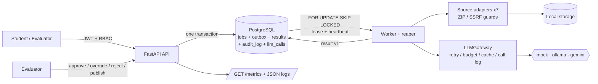

# AI-Powered Project Evaluation Platform — proof of concept

A small, runnable POC of the **core logic** of an automated project-evaluation platform: submissions with
seven artifact types go through a queue-backed pipeline (extract → deterministic facts → summaries →
one LLM call per rubric criterion → aggregate → route), and a human reviewer can approve, override,
reject and publish results.

It costs nothing to run: no cloud accounts, no paid services. The default LLM is a **deterministic mock**.
It is a heuristic stand-in, not a model, so scores in this repo say nothing about real grading quality.

> Honesty note: this POC does **not** use AWS, S3, SQS, Fargate, GuardDuty or any Bedrock/Claude API.
> Those names appear only as the production counterparts that each POC piece is shaped to be replaced by.
> Only the `mock` provider has been run (see [`samples/`](samples/README.md)).

## Quick start (3 commands)

```bash
python -m venv .venv && .venv/bin/pip install -r requirements.txt   # Windows: .venv\Scripts\pip ...
python tasks.py up       # Postgres via Docker Compose + create tables + seed users/rubric
python tasks.py demo     # full flow end to end with the mock provider
```

Other commands: `python tasks.py test | calibrate | cost`. Interactive API docs: run
`uvicorn app.main:app` and open `/docs` (or `python tasks.py up --all` for the Compose api + worker).
Seeded dev logins (password `password`): `student1@example.com`, `student2@example.com`,
`evaluator@example.com`, `admin@example.com`.

**How this was actually run:** on Windows 11 with Python 3.12.10 and a *portable PostgreSQL 16.15* (no
Docker on this machine). `docker-compose.yml`, the `Dockerfile` and `tasks.py up` were therefore **never
executed** — see the status table. Tests and the demo only need a Postgres reachable at
`DATABASE_URL` / `TEST_DATABASE_URL` (defaults in `.env.example`).

## Architecture



| POC piece | Production counterpart it is shaped to be replaced by |
|---|---|
| Postgres `jobs` + `outbox` (claim with SKIP LOCKED, lease, reaper, `dead` = DLQ) | a managed queue such as SQS with a DLQ |
| `Storage` interface → local folder | an object store such as S3 |
| `LLMGateway` → mock / ollama / gemini | a managed model endpoint (Bedrock / Claude API) behind the same gateway |
| JSON logs + `GET /metrics` | CloudWatch / OpenTelemetry / an LLM-tracing tool such as Langfuse |
| Seeded users + JWT | an identity provider |
| ZIP validation + SSRF guard | the same code plus a sandboxed fetcher / egress proxy and a malware scanner |

## What is implemented, and how it was verified

Statuses: **Implemented and tested** (an automated test in `tests/` passes) · **Implemented, not tested** ·
**Fixture only** (works against local fixtures, not the real service) · **Not implemented**.

### Features

| Feature | Status | Evidence / caveat |
|---|---|---|
| Idempotent create (same `Idempotency-Key` → one submission, scoped per user) | Implemented and tested | `test_idempotency.py` |
| Start-evaluation ×5 → one job; concurrent start → one active job (`uq_active_job`) | Implemented and tested | 8 threads released by a barrier |
| Worker claim with SKIP LOCKED, lease, heartbeat, stale-worker fencing | Implemented and tested | `test_queue.py` |
| Crash mid-stage → reaper requeues → resumes without redoing finished stages | Implemented and tested | crash simulated with a `BaseException` |
| Job → `dead` after N failures (and via lease expiry) | Implemented and tested | `test_queue.py` |
| Optimistic `version` column | Implemented, **not tested in isolation** | bumped on every transition and part of the claim's `WHERE`; no test provokes a version conflict |
| Versioned, immutable-once-published rubrics (DB trigger) | Implemented and tested | `test_rubrics.py` |
| JWT auth, RBAC, ownership (404 for other students' data) | Implemented and tested | token expiry not tested |
| ZIP-slip, ZIP-bomb (ratio + size), file count, symlink, allowlist | Implemented and tested | `test_security.py` |
| SSRF guard (loopback/private/link-local/IPv6-mapped, https-only, redirect re-validation, size cap) | Implemented and tested | DNS-rebinding race **not** closed (documented in `ssrf.py`) |
| Prompt-injection detector + data delimiting | Implemented and tested | regex heuristic; trivially evadable by a determined attacker |
| LLM gateway: retry/backoff, token budget, cache by hash(prompt + rubric version), `llm_calls` log | Implemented and tested | `test_llm_gateway.py` |
| `mock` provider | Implemented and tested | deterministic, deliberately *gullible* to injected text |
| `ollama` and `gemini` providers | **Implemented, not tested** | never run; no key / server was available |
| Pipeline: facts, relevant-file selection, ignore lists, chunking, per-file summaries | Implemented and tested | 600 KB project → every call < 12k tokens |
| One LLM call per criterion; strict pydantic JSON; retry once with the error; then `needs_review` | Implemented and tested | `test_pipeline.py` |
| Evidence hallucination guard (quote must exist verbatim in cited file) | Implemented and tested | |
| Decimal aggregation in code | Implemented and tested | float-vs-Decimal case asserted |
| Routing: low confidence, failed/skipped artifact, injection flag, score near boundary, random audit | Implemented and tested | `test_routing.py`; audit sample is deterministic per job id (10%) |
| Failed artifact → warning + lower confidence + review, never a failed evaluation | Implemented and tested | |
| Evaluator queue, approve / override (new version) / reject, audit log | Implemented and tested | `test_review.py` |
| Publish: one published result (`uq_one_published_result`), double publish → 409, concurrent publish | Implemented and tested | |
| Students see only published results; evaluators see all versions | Implemented and tested | |
| JSON logs with `job_id`/`submission_id`; `GET /metrics` | Implemented and tested | |
| Golden set + `calibrate`; `cost` report with 30 and 10,000/day projection | Implemented and tested | expected scores are hand-assigned for 3 tiny projects |
| `docker-compose.yml`, `Dockerfile`, `tasks.py up` | **Implemented, not tested** | Docker is not installed on the build machine |
| macOS / Linux | **Implemented, not tested** | only run on Windows 11; code avoids OS-specific calls |
| Scale to 10,000 submissions/day | **Not implemented** | projection is arithmetic only; never load-tested |
| Sandboxed code execution, malware scanning, multi-AZ | **Not implemented** | by design: static analysis only |

### Artifact types (all 7 are accepted by the API and run through the pipeline)

| Artifact | Status | What was actually verified |
|---|---|---|
| `github` | Implemented and tested | tested against a local git repo (the network clone is swapped for a local one). Separately, a **manual, non-suite** run cloned `octocat/Hello-World` successfully and a missing repo returned `failed`. |
| `zip` | Implemented and tested | extraction, zip-slip rejection, executable skipping |
| `pdf` | Implemented and tested | hand-built PDF; garbage → `failed`. Scanned PDFs → `partial` (no OCR) |
| `documentation` | Implemented and tested | md and docx |
| `live_url` | Implemented and tested | real local HTTP server (guard's test-only override enabled in that test); blocked by default |
| `google_drive` | **Fixture only** (+ real path *Implemented, tested only against mocked API responses*) | no `GOOGLE_API_KEY` was available. Fixture folder → status `fixture`; private → `skipped` / `auth required` |
| `video` | Implemented and tested (transcript path); ffprobe and faster-whisper **not tested** | `ffprobe` is not installed here and `faster-whisper` was never installed. Transcript upload, missing transcript → `partial`, >20 min → `skipped` (via patched probe and via SRT-derived duration) are tested |

## Test output (clean clone, real run)

Cloned the repo into a fresh directory, created a new venv, `pip install -r requirements.txt`, then
`python tasks.py test` (full verbose output in `samples/mock_tests.txt`):

```
collected 115 items

tests\test_adapters.py ...............                                   [ 13%]
tests\test_auth.py .....                                                 [ 17%]
tests\test_calibrate_cost.py ...                                         [ 20%]
tests\test_idempotency.py .......                                        [ 26%]
tests\test_llm_gateway.py ........                                       [ 33%]
tests\test_observability.py ....                                         [ 36%]
tests\test_pipeline.py ...........                                       [ 46%]
tests\test_queue.py ......                                               [ 51%]
tests\test_review.py ...........                                         [ 60%]
tests\test_routing.py ......                                             [ 66%]
tests\test_rubrics.py ....                                               [ 69%]
tests\test_security.py ..................................                [ 99%]
tests\test_smoke.py .                                                    [100%]

============================ 115 passed in 48.17s =============================
```

## Demo output (`python tasks.py demo`, clean clone, mock provider)

```
== 4. Worker drains the queue
   good: {"status": "completed", "stage": "route", "attempts": 1}
   malicious: {"status": "needs_review", "stage": "route", "attempts": 1}
   bad-zip: {"status": "needs_review", "stage": "route", "attempts": 1}
== 5. Visibility rules
   student reads unpublished result -> HTTP: 404
   other student reads submission -> HTTP: 404
== 6. Evaluator review queue
   malicious: {"total": "100.00", "reasons": ["injection_flag:README.md"]}
   bad-zip: {"total": "17.50", "reasons": ["low_confidence:code_quality=0.30", ..., "artifact_failed:zip(zip rejected: path traversal (zip-slip) ...)"]}
== 7. ...
   publish good: "published"
   publish good again -> HTTP: 409
   override -> new version: {"version": 2, "total": "31.00"}
```

Full output: `samples/mock_demo.txt`. Note the malicious README scored **100.00** from the mock — it is
gullible on purpose; it was the *detector and routing* that held it back from the student.

## Golden-set calibration (`python tasks.py calibrate`, mock provider)

| project | expected total | got | delta | routed because |
|---|---|---|---|---|
| good | 82.5 | 79.0 | −3.5 | `random_audit_sample` in this run (deterministic per job id, so it varies between runs) |
| weak | 22.5 | 33.5 | +11.0 | `low_confidence:code_quality=0.50` |
| malicious_readme | 33.5 | 100.0 | **+66.5** | `injection_flag:README.md` |

Mean absolute total delta 27.0. The large malicious delta is the point of that sample: the model-side
score is untrustworthy, and the pipeline prevents it from being auto-approved. These deltas measure a
heuristic mock against expectations the author hand-assigned; they are **not** evidence of real-LLM accuracy.

## Cost report (`python tasks.py cost`)

Token counts are the mock's chars/4 estimate; cost is at an *assumed* reference price of
$1.00 / 1M input and $5.00 / 1M output tokens (not a vendor quote). Actual spend here is $0.

| submissions/day | LLM calls/day | tokens/day | est. $/day | est. $/30 days |
|---|---|---|---|---|
| 30 | 200 | 77,070 | 0.10 | 3.05 |
| 10,000 | 66,666 | 25,690,000 | 33.91 | 1,017.30 |

Derived from 6 evaluations averaging 2,364 tokens in / 206 out / 6.7 calls each. This is linear
arithmetic (no retries, no cache hits, mock-sized outputs). It is **not** a capacity test.

## API overview (see `/docs` for the generated OpenAPI)

| Method & path | Who | Purpose |
|---|---|---|
| `POST /auth/login` | anyone | JWT |
| `POST /submissions` (`Idempotency-Key` required) | authenticated | create submission |
| `POST /submissions/{id}/artifacts` | owner | upload/attach one of 7 artifact types |
| `POST /submissions/{id}/evaluations` | owner / staff | start evaluation (idempotent) |
| `GET /evaluations/{id}` | owner / staff | status, stage, attempts |
| `GET /evaluations/{id}/result` | owner → published only; staff → all versions | result |
| `GET /review/queue` | evaluator, admin | evaluations needing review |
| `POST /evaluations/{id}/approve \| override \| reject \| publish` | evaluator, admin | review actions, all audited |
| `GET /metrics` | evaluator, admin | queue depth, oldest job age, tokens, cost |

## Known limitations

- **No sandbox execution.** Student code is never run; everything is static text analysis, so
  "functionality" is inferred from README and structure, not from running the project.
- **No malware scanner.** ZIPs are checked structurally and by file type, not scanned for malicious payloads.
- **Prompt-injection defence is heuristic** (regex detector + delimiting + human routing). A paraphrased
  attack may evade the detector; the gullible mock only demonstrates the flagged case.
- **SSRF:** validation and connection resolve DNS separately (rebinding window). The `SSRF_ALLOW_PRIVATE`
  env override exists for tests and must never be set in a deployment.
- **Single region, single Postgres, no multi-AZ, no HA, no backups.**
- **Does not scale to 10,000/day as built:** one in-process worker loop, polling every second, local
  disk storage, no rate limiting, no backpressure on LLM provider limits.
- **Video:** no frame analysis; transcription needs the optional `faster-whisper` package (not installed
  or tested) and long videos are skipped.
- **Google Drive** real-API behaviour is unverified against Google; only public items are supported.
- Seeded dev passwords and a default JWT secret are for local use only; no refresh tokens, rate limits or lockout.
- Cache-hit tokens are recorded with their original size (cost $0) so cold cost can be reported; the
  cache has no TTL or eviction.

## What was not done

- No run with `ollama` or `gemini` (no key / server): `samples/` contains mock output only.
- `docker compose up`, the `Dockerfile` build, and `python tasks.py up` were never executed (no Docker here).
- Nothing was run on macOS or Linux.
- ffprobe and faster-whisper paths, and the real Google Drive API, were not exercised.
- No load or capacity test; the 10,000/day figures are arithmetic.
- No test isolates an optimistic-`version` conflict.
- No frontend; `/docs` is the only UI.

## Layout

```
app/        api/ adapters/ llm/ pipeline/ queue/ security/ storage/  + models, auth, rubrics, cost, calibrate
golden/     good/ weak/ malicious_readme/ + expected.json
fixtures/   drive/ (fixture Google Drive folders)
scripts/    demo.py
tests/      115 tests, offline, mock provider
samples/    outputs of the verified clean-clone run (mock provider only)
tasks.py    up | test | demo | calibrate | cost
```
